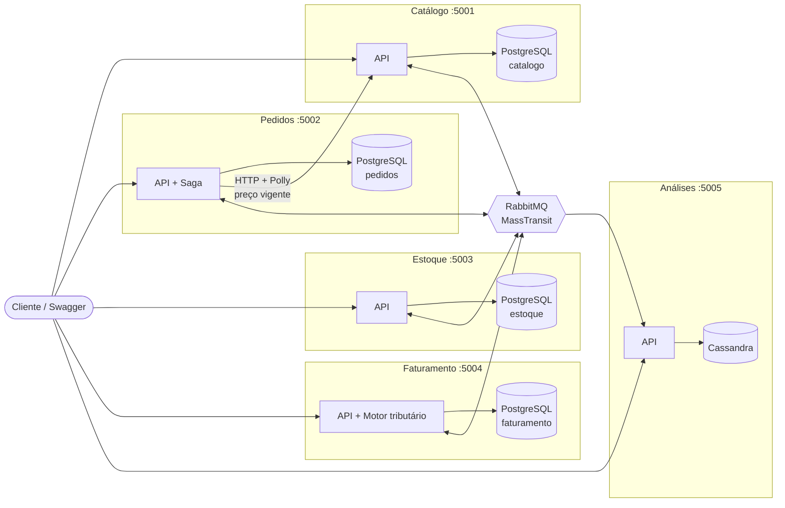
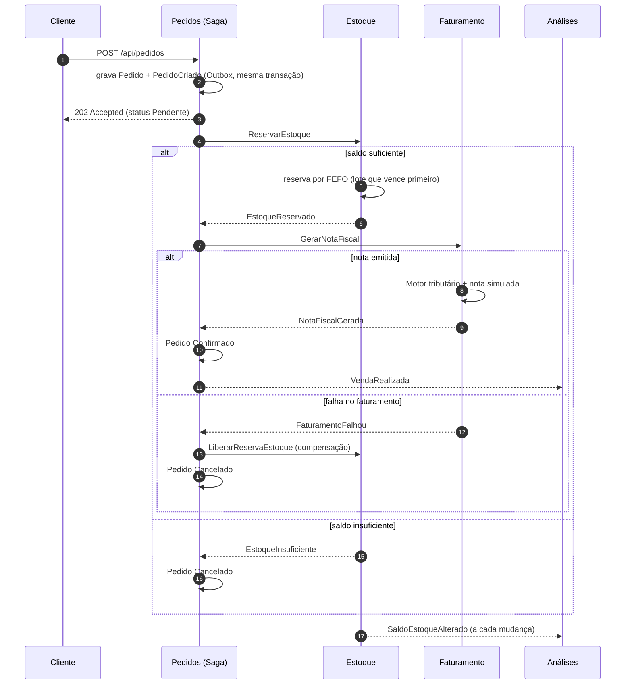

# SalesGreen — microsserviços de varejo em .NET

[](https://github.com/Mariohcb95/sales-green/actions/workflows/ci.yml)

Projeto de portfólio que simula o backend de um varejo (mercados, hortifrútis): catálogo com **importação de planilhas**, pedidos, estoque com **lotes e validade**, faturamento com **motor tributário preparado para IBS/CBS** e uma projeção analítica em **Cassandra** (risco de ruptura, vendas por dia). Serve de base para o **EconoMax**.

O foco é demonstrar práticas de backend .NET moderno — e o **porquê** de cada uma está registrado em [`docs/adr/`](docs/adr).

## O problema

Um pequeno varejista precisa:
1. **Cadastrar ou importar** produtos de planilhas, sem duplicar nada e sabendo exatamente quais linhas tinham erro;
2. **Vender** só o que tem em estoque, priorizando o lote que vence primeiro (menos perda em perecíveis);
3. **Faturar** com o cálculo de tributos correto para o cenário vigente — inclusive a transição da reforma tributária;
4. **Antecipar rupturas** a partir do ritmo de vendas.

Cada passo vive em um serviço independente; o fluxo do pedido é coordenado por uma **Saga** com compensação.

## Arquitetura



Cada serviço segue **Clean Architecture** (exceto Análises, que é só uma projeção de leitura):

```
src/
├── SharedKernel/      Value objects (Dinheiro, Quantidade, CodigoProduto), Entity, AggregateRoot, exceções
├── Contracts/         Mensagens de integração (só tipos primitivos)
├── BuildingBlocks/    Serilog, ProblemDetails, health checks, MassTransit (Outbox/retry), DbContext base
└── Services/
    ├── Catalogo/      Domain · Application · Infrastructure · Api
    ├── Pedidos/       Domain · Application (Saga) · Infrastructure (Polly) · Api
    ├── Estoque/       Domain · Application · Infrastructure · Api
    ├── Faturamento/   Domain (Motor tributário) · Application · Infrastructure · Api
    └── Analises/      Api (projeção em Cassandra)
tests/
├── SalesGreen.UnitTests         xUnit — domínio, casos de uso, planilhas, Saga (test harness)
└── SalesGreen.IntegrationTests  Testcontainers — PostgreSQL + RabbitMQ reais
```

## Fluxo de eventos



Importação de planilha: `POST /api/produtos/importacoes` → 202 → `ImportacaoProdutosSolicitada` (Outbox) → consumidor valida linha a linha e faz upsert por código → `ProdutoCadastrado` → Estoque cria o item → relatório em `GET /api/produtos/importacoes/{id}`.

## Tecnologias

| Tema | Escolha |
|---|---|
| Plataforma | .NET 10 (LTS), ASP.NET Core Web API, C# 14 |
| Domínio | DDD (agregados, value objects, domain events), Clean Architecture, SOLID |
| Persistência | PostgreSQL 17 (um banco por serviço), EF Core 10 + migrations, Dapper (relatórios) |
| Mensageria | RabbitMQ 4 + MassTransit 8 — Outbox/Inbox, retry, DLQ (`_error`), Saga state machine |
| Resiliência | Polly v8 (`Microsoft.Extensions.Http.Resilience`): timeout, retry com jitter, circuit breaker |
| NoSQL | Apache Cassandra 5 (projeção analítica) |
| Planilhas | CSV (leitor próprio) e XLSX (ClosedXML) |
| Observabilidade | Serilog (JSON estruturado), health checks `/health/live` e `/health/ready` |
| Erros | ProblemDetails (RFC 9457) com `traceId` |
| Testes | xUnit, FluentAssertions, MassTransit Test Harness, Testcontainers, WebApplicationFactory |
| Entrega | Docker (multi-stage, usuário não-root), Docker Compose, GitHub Actions, SonarCloud |

## Como rodar localmente

Pré-requisito: Docker. (Para rodar fora do Docker: .NET 10 SDK.)

```bash
docker compose up --build -d
```

Sobe PostgreSQL, RabbitMQ, Cassandra e os 5 serviços (as migrations rodam sozinhas na subida). O Cassandra leva ~1 minuto para ficar pronto.

| Serviço | Swagger | Health |
|---|---|---|
| Catálogo | http://localhost:5001/swagger | http://localhost:5001/health/ready |
| Pedidos | http://localhost:5002/swagger | http://localhost:5002/health/ready |
| Estoque | http://localhost:5003/swagger | http://localhost:5003/health/ready |
| Faturamento | http://localhost:5004/swagger | http://localhost:5004/health/ready |
| Análises | http://localhost:5005/swagger | http://localhost:5005/health/ready |
| RabbitMQ (painel) | http://localhost:15672 (salesgreen / salesgreen_dev) | |

Para ver o fluxo inteiro (importação, caminho feliz, estoque insuficiente, compensação, análises e simulação tributária):

```bash
./scripts/demo.sh
```

> Credenciais do compose são **apenas para desenvolvimento**. Para trocar senhas ou portas (ex.: se a 5432 ou a 9042 já estiverem em uso), copie `.env.example` para `.env` e ajuste.

Rodando um serviço fora do Docker (com a infraestrutura do compose no ar):

```bash
docker compose up -d postgres rabbitmq cassandra
dotnet run --project src/Services/Catalogo/SalesGreen.Catalogo.Api
```

### Exemplo rápido

```bash
# modelo de planilha
curl -o modelo.csv http://localhost:5001/api/produtos/importacoes/modelo.csv
# importação assíncrona (responde 202 + link do relatório)
curl -i -F "arquivo=@modelo.csv;type=text/csv" http://localhost:5001/api/produtos/importacoes
# entrada de estoque de um perecível (exige lote com validade)
curl -X POST http://localhost:5003/api/estoque/entradas -H "Content-Type: application/json" \
  -d '{"produtoCodigo":"HF-TOMATE","quantidade":20,"lote":"L1","validade":"2026-12-31"}'
# pedido (o preço vem do Catálogo, não do cliente)
curl -X POST http://localhost:5002/api/pedidos -H "Content-Type: application/json" \
  -d '{"cliente":"Mercado Exemplo","itens":[{"produtoCodigo":"HF-TOMATE","quantidade":2.5}]}'
```

## Como rodar os testes

```bash
dotnet test
```

- `SalesGreen.UnitTests` — não precisa de nada além do SDK.
- `SalesGreen.IntegrationTests` — precisa do **Docker** rodando (o Testcontainers sobe PostgreSQL e RabbitMQ descartáveis).

Só os de unidade: `dotnet test tests/SalesGreen.UnitTests`.

## CI

[`.github/workflows/ci.yml`](.github/workflows/ci.yml): restore → build → testes de unidade e integração com cobertura → análise no **SonarCloud** → build das imagens Docker.

Para ativar o SonarCloud: importe o repositório em sonarcloud.io, desative a "Automatic Analysis" e crie o secret `SONAR_TOKEN` no GitHub. Se a organização/chave do projeto forem diferentes de `mariohcb95` / `Mariohcb95_sales-green`, defina as variables `SONAR_ORGANIZATION` e `SONAR_PROJECT_KEY`. Sem o token, o pipeline roda normalmente e só pula a análise.

## Decisões técnicas

Resumo dos ADRs (detalhes, alternativas e "como defender" em cada arquivo):

| # | Decisão | Em uma frase |
|---|---|---|
| [0001](docs/adr/0001-registrar-decisoes-de-arquitetura.md) | Registrar ADRs | O porquê fica versionado junto do código. |
| [0002](docs/adr/0002-microsservicos-ddd-clean-architecture.md) | Microsserviços + DDD + Clean Architecture | Um serviço por bounded context; domínio isolado de framework; invariantes nos agregados. |
| [0003](docs/adr/0003-persistencia-postgresql-efcore-dapper.md) | PostgreSQL, EF Core e Dapper | Banco por serviço; EF para escrita com agregados, Dapper para relatórios; concorrência otimista no estoque. |
| [0004](docs/adr/0004-mensageria-outbox-idempotencia-retry-dlq.md) | Outbox, idempotência, retry e DLQ | Evento gravado na mesma transação do dado; consumidores idempotentes (Inbox + chaves de negócio). |
| [0005](docs/adr/0005-saga-orquestrada-do-pedido.md) | Saga orquestrada | State machine explícita com compensação (liberar estoque) e eventos duplicados ignorados. |
| [0006](docs/adr/0006-importacao-assincrona-de-planilhas.md) | Importação assíncrona | 202 + fila; validação do arquivo pelo conteúdo; upsert idempotente por código; relatório de rejeições. |
| [0007](docs/adr/0007-motor-tributario-no-dominio.md) | Motor tributário | Uma regra por tributo (Strategy); cenários Regime atual, Transição 2026 (CBS/IBS) e Reforma plena. |
| [0008](docs/adr/0008-resiliencia-http-com-polly.md) | Polly | Timeout, retry com jitter só para erro transitório e circuit breaker; 503 quando o Catálogo cai. |
| [0009](docs/adr/0009-cassandra-para-analises.md) | Cassandra nas análises | Modelagem query-first; idempotência pela chave; `USING TIMESTAMP` contra eventos fora de ordem; quando *não* usar. |
| [0010](docs/adr/0010-seguranca-e-observabilidade.md) | Segurança e observabilidade | OWASP (injeção, upload, formula injection, segredos), ProblemDetails, Serilog, health checks. |
| [0011](docs/adr/0011-estrategia-de-testes.md) | Testes | Domínio com xUnit, saga com test harness, integração com Testcontainers (que acharam 2 bugs reais). |
| [0012](docs/adr/0012-versoes-e-licencas.md) | Versões e licenças | .NET 10 LTS; MassTransit 8 e FluentAssertions 7 (licenças livres); sem MediatR. |

## Próximos passos

- Autenticação/autorização (JWT/OIDC) e rate limiting.
- Timeout na Saga (`Schedule`) para pedidos parados.
- OpenTelemetry (traces distribuídos HTTP + RabbitMQ).
- Cache local de preços no Pedidos alimentado por eventos (remover a chamada síncrona).
- Regras tributárias por NCM/UF com alíquotas em tabela.
